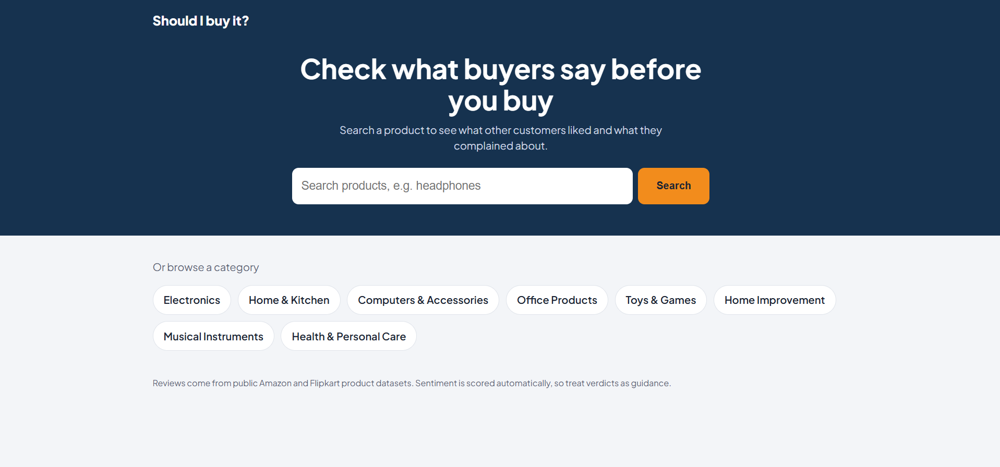
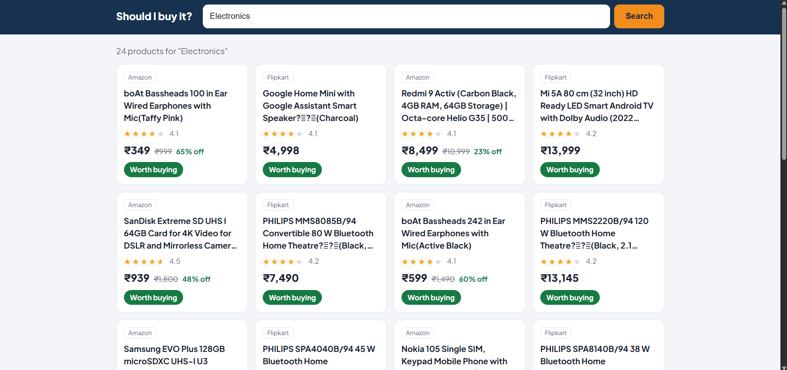
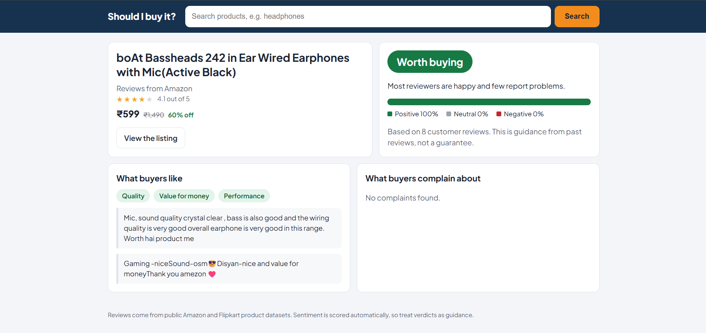

# Should I Buy It?

A small web app that helps you decide whether to buy a product, based on what other customers said in their reviews. You search for a product, and it shows how many reviews were positive, neutral or negative, what buyers like and complain about, and a simple verdict: **Worth buying**, **Mixed** or **Think twice**.

Built with Python, Flask, SQLite and VADER, using public Amazon and Flipkart review datasets. It runs locally.





## What it does

- Search by product name or category. Amazon and Flipkart results are mixed together, and each card shows which store the reviews came from.
- Each product page shows a verdict, the share of positive, neutral and negative reviews, what buyers like, what they complain about, and a few example reviews.
- Products with fewer than 5 reviews get "Not enough data" instead of a verdict.

## How it works

Run the scripts in this order:

| Script | What it does |
|---|---|
| `clean_amazon.py` | Cleans the Amazon dataset (prices, ratings, categories) and splits the packed review text into one row per review |
| `load_to_sqlite.py` | Loads the cleaned Amazon data into a SQLite database (`reviews.db`) |
| `add_flipkart.py` | Cleans the Flipkart dataset and adds it to the same database |
| `categorize_flipkart.py` | Gives Flipkart products a category using keywords in their names |
| `analyze_reviews.py` | Scores every review as positive, neutral or negative with VADER, and tags what it talks about (quality, durability, value for money and so on) |
| `check_sentiment.py` | Checks the sentiment scores against Flipkart star ratings |
| `app.py` | The Flask web app |

## The data

- **Amazon:** [Amazon Sales & Product Analysis](https://www.kaggle.com/datasets/arshuuuuuuu/amazon) from Kaggle, 1,351 products. In the file, each product's reviews are packed into one cell, so I split them apart. 1,048 products had review text I could split reliably, giving 7,268 reviews. The other 303 products were skipped, because their text could not be matched up safely.
- **Flipkart:** [Flipkart Products Review Dataset](https://www.kaggle.com/datasets/niraliivaghani/flipkart-dataset) from Kaggle, 363,261 rows. After removing duplicates, empty reviews and invalid ratings, 304,147 remained. I kept the 300 products with the most reviews (at least 20 each) and a random sample of up to 50 reviews per product, giving 15,000 reviews.

The combined database has 1,651 products and 22,268 reviews. The datasets are not included in this repository; download them from Kaggle (see below).

## How the verdict works

- **Not enough data:** fewer than 5 analysed reviews.
- **Think twice:** average rating under 3.5, or fewer than 55% of reviews positive, or 30% or more negative.
- **Worth buying:** at least 75% positive, no more than 15% negative, and a rating of 4.0 or higher.
- **Mixed:** everything in between.

These thresholds are my own judgement calls, not tuned against any data. They are easy to change in `get_verdict()` in `app.py`.

## How well does the sentiment scoring work?

The Flipkart reviews come with star ratings, so I compared VADER's labels with them (4-5 stars = positive, 3 = neutral, 1-2 = negative) on all 15,000 reviews:

- 87.3% agreement overall, and 94.8% on clearly positive or negative reviews (1-2 and 4-5 stars).
- For context, 74% of these reviews are 4-5 stars, so always guessing "positive" would score 74.0% overall (81.0% on the clear reviews).
- It was strongest on positive reviews (98% correct) and weaker on negative ones (80% correct). It was poor on 3-star reviews: only 107 of 1,300 were scored neutral, and most were scored positive.
- Because of this, the app leans optimistic: some bad reviews are scored as positive.

`check_sentiment.py` reproduces these numbers.

## Limitations

- VADER only understands English, so Hindi-English mixed reviews may be scored as neutral.
- It scores a whole review at once, so a review that praises one thing and criticises another can be misread.
- Themes come from a simple keyword list, so some reviews are tagged "other".
- Amazon products have only about 7 reviews on average, so their verdicts rest on a small sample.
- Flipkart products were given categories by keyword rules on their names, so a few may be misfiled, and some have no category.
- The app runs locally and is not deployed.

## What I would do next

- Use the star rating directly when it is available, and keep VADER only for reviews without one.
- Try a stronger sentiment model that handles longer reviews and mixed languages.
- Score each point in a review separately, instead of the whole review.
- Test the verdict thresholds against star ratings.
- Deploy it online.

## Run it yourself

1. Download both datasets from Kaggle and save the CSV files as `amazon.csv` and `flipkart.csv` in the project folder.
2. Install the libraries: `pip install -r requirements.txt`
3. Run the scripts in order:
   ```
   python clean_amazon.py amazon.csv
   python load_to_sqlite.py
   python add_flipkart.py flipkart.csv
   python categorize_flipkart.py
   python analyze_reviews.py
   python check_sentiment.py
   python app.py
   ```
4. Open http://127.0.0.1:5000 in your browser.

Note: `load_to_sqlite.py` starts the database from scratch, so run it only once, before `add_flipkart.py`.

## Credits

Review data comes from the two Kaggle datasets linked above, which belong to their original authors. Sentiment scoring uses [VADER](https://github.com/cjhutto/vaderSentiment).
